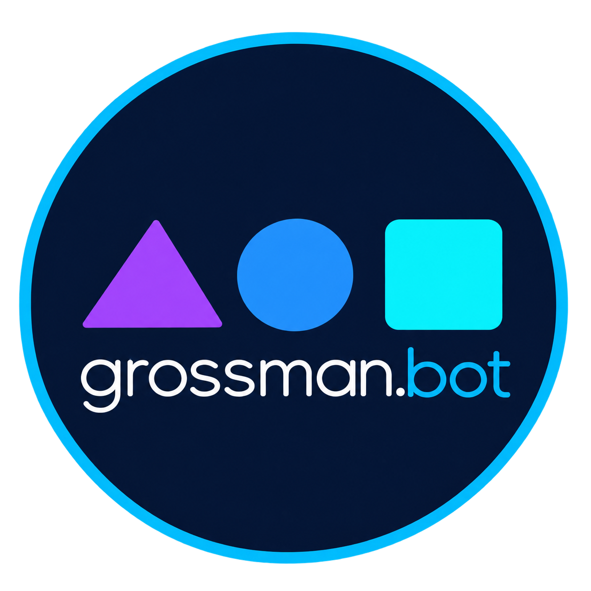
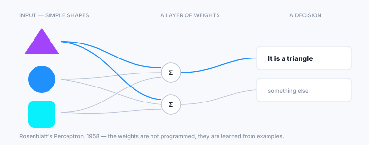
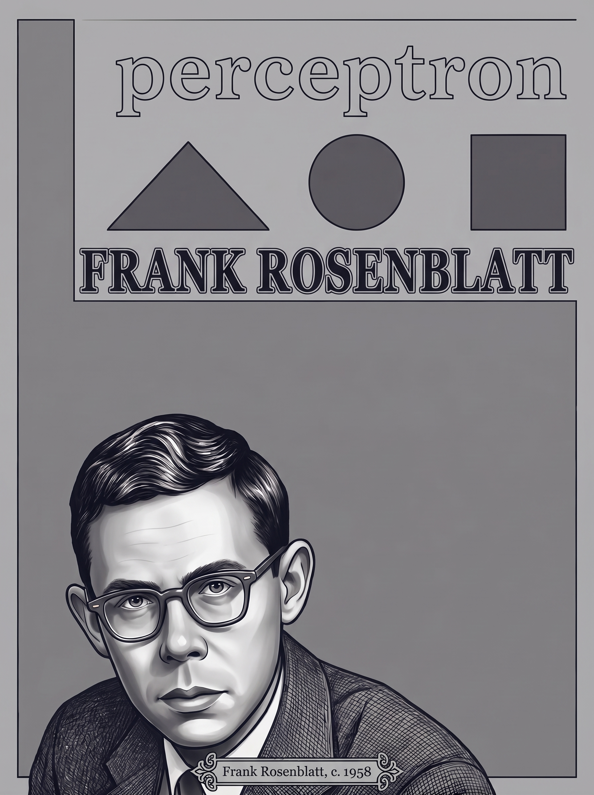

# 01. What ScenarioBot does

**How to get there:** this is background — nothing to open.

## Brand structure

Two names appear throughout the product, and they are not interchangeable.

**Grossman.bot** — the company and the main brand identity. It represents the
broader technology, the vision, and the future product ecosystem.

**ScenarioBot** — the core product built by Grossman.bot. A platform for
designing, testing, automating and monitoring WhatsApp conversational
scenarios.

So: Grossman.bot is who makes it, ScenarioBot is what you use. The web address
is `grossman.bot`, the product you are signed into is ScenarioBot, and more
products may sit under the same brand later.

> **ScenarioBot by Grossman.bot**
> Design. Test. Automate.

### The story behind the logo



A purple **triangle △**, a blue **circle ○**, a cyan **square □**. They are not
decoration, and they are not arbitrary — they are the first thing a machine was
ever taught to recognise.

In 1958 **Frank Rosenblatt**, at the Cornell Aeronautical Laboratory, built the
**Perceptron**: one of the earliest working models of an artificial neural
network, and the ancestor of everything that is now called AI. It was a room of
hardware wired to a grid of photocells, and what it was trained to do was look
at a simple shape and say which one it was.



**The important part is what it was not.** Nobody wrote a rule that a triangle
has three sides. The machine was shown examples, it guessed, it was told when it
was wrong, and the connection strengths shifted a little each time. The
behaviour was *learned from examples*, not programmed — the idea every model
since has been built on.



> *Frank Rosenblatt (1928–1971). Illustration, not a photograph.*

That is why the three shapes are the mark. On their own they are the simplest
things you can show something. Together they stand for the whole idea: take raw
input, recognise the pattern, produce a decision.

And it is a fair description of the product. ScenarioBot takes messages,
scenarios, data and the replies people actually send, and turns them into
decisions that run by themselves — a conversation that reacts to the answer it
gets rather than reading from a script.

From a machine learning to tell a triangle from a square, to a platform that
learns what to do with an answer.

## What ScenarioBot does

ScenarioBot runs scripted WhatsApp conversations for you.

You connect a WhatsApp number, draw a conversation as a flow — what the bot
sends, what it expects back, what to do when the answer isn't what you expected
— and then either run it on demand or put it on a schedule. Every run is
recorded, so you can open any past conversation and see exactly which step sent
what, what came back, and where it went wrong.

### Three things it is for

| | |
|---|---|
| **Automation** | a conversation that runs itself — reminders that confirm or reschedule, recurring check-ins, intake questionnaires |
| **Performance** | the same conversation run against many phones at once, to see how a bot holds up under load ([Chapter 13](13-executions.md)) |
| **Monitoring** | a scheduled run that checks another WhatsApp bot still answers correctly, and tells you when it stops ([Chapter 09](09-schedules.md)) |

They are the same machinery, pointed at three different problems. A scenario
you wrote to remind customers of an appointment is also, unchanged, a probe
that tells you at 7am that your own bot has stopped replying.

A run can collect what it needs from outside WhatsApp too: a code that arrives
by **SMS** on a rented handset ([Chapter 21](21-sms.md)), or by **email** to the
phone's own address ([Chapter 24](24-mail.md)) — which is how a scenario can
sign in to a service that verifies by email.

**What you can do depends on your plan** — how many bots (agents), phones and
schedules you may have, and whether the API and load testing are switched on.
The limits are on the pricing page; the screens are the same either way, and a
limit shows up as an action being refused rather than a feature disappearing.

The interface is **translated**, and you pick the languages you want in the
🌐 menu — Hebrew and Arabic flip the whole layout right-to-left
([Chapter 22](22-languages.md)). It comes in **light and dark**
([Chapter 14](14-settings.md#light-and-dark-mode)), and **every screen has its
own address**, so anything you are looking at can be bookmarked or sent to a
colleague ([the map](README.md#every-screen-has-an-address)).

## The six things you work with

**Phone** — a WhatsApp number you've connected. Each one runs in isolation, has
its own bots (agents) and its own scenarios. A phone is either active or
disconnected. → [Chapter 03](03-phones.md)

**Bot (Agent)** — someone that phone can talk to. Not just a number typed into a
box; a bot (agent) has to be verified through a handshake before anything will run
against it. → [Chapter 04](04-contacts.md)

**Scenario** — the conversation script. Built visually, saved as a draft, then
published when it's ready to run. → [Chapter 05](05-scenarios.md)

**Call** — one execution of one scenario against one bot (agent). This is the unit
you look at afterwards. **A bot (agent) can only have one call running at a time.**
→ [Chapter 11](11-reading-a-call.md)

**Schedule** — a rule that fires a scenario at chosen times.
→ [Chapter 09](09-schedules.md)

**Template** — a pre-approved WhatsApp message format with `{{1}}`-style
placeholders. Managed separately, and the only way to open a conversation
outside WhatsApp's 24-hour window. → [Chapter 08](08-templates.md)

## How they fit together

```
Phone ──┬── has many Contacts ──── has many Calls
        └── has many Scenarios ─── run against a Contact = a Call
                                    ▲
                          Schedule ─┘  (fires it on a timer)
```

A call always needs three things: **a phone, a scenario, and a bot (agent).** If any
one of them is missing or not ready, nothing runs.
