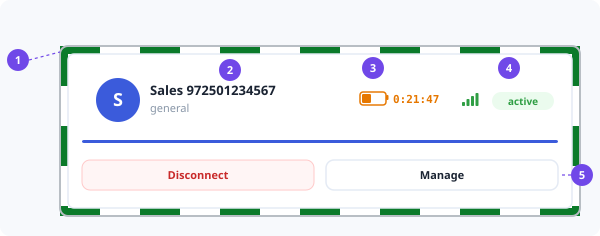
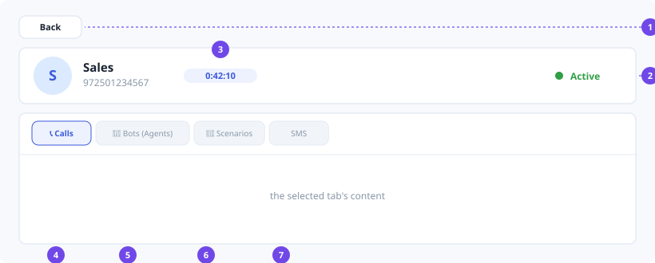

# 03. Connecting a phone

**How to get there:** **Top bar → Phones**. This is the screen you land on after
signing in.

**URL:** [grossman.bot/phones](https://grossman.bot/phones)

Also [grossman.bot/phones/new](https://grossman.bot/phones/new) to add one, and `grossman.bot/phones/<phone>/reconnect` to reconnect.

## The phone list

Every number you've connected, as a card showing its nickname, number, label,
colour and live status.

| Status | Meaning |
|---|---|
| **Active** | linked and working |
| **Disconnected** | the WhatsApp session dropped — nothing will run |

Each card has actions for disconnecting and reconnecting. **Clicking the card
itself opens that phone** — see [Phone Detail](#what-is-inside-a-phone) below.

There's also a **Templates** tab on this screen → [Chapter 08](08-templates.md).

### Reading a card at a glance

| # | Component | What it tells you |
|---|---|---|
| **1** | Rented frame | the green-and-white stripes mean this phone is **rented**, not yours ([Chapter 20](20-rented-phones.md)) |
| **2** | Name and number | the nickname you gave it, then the number itself |
| **3** | Rental battery | how much of the rental is left — rented phones only |
| **4** | Signal and status | reception bars plus the status badge |
| **5** | Actions | Disconnect / Reconnect, and Manage to open the phone |

Clicking anywhere on the card except a button opens the phone.

Three things on the card tell you where a phone stands without opening it.

**📶 Signal bars** — on every phone:

| Bars | Means |
|---|---|
| four, **green** | active and working |
| four, **grey** | an action is in progress — the card is also dimmed |
| empty outline with a **red ✕** | disconnected |

**A green-and-white striped frame** means the phone is **rented** — the frame
runs all the way round the card, so a rented phone is recognisable from across
the screen without reading anything ([Chapter 20](20-rented-phones.md)).

**🔋 A battery gauge**, on rented phones only, beside the signal bars:

- it **drains as the rental runs**, so how full it is tells you how much of your
  time is left at a glance
- **green** over half, **amber** under half, **red** for the last stretch
- the exact time left is printed next to it

The red threshold is the same moment you get the "ending soon" notification, so
a red battery and a bell are the same news twice.

### A dimmed card means something is happening

Disconnecting is not instant — the card dims, the bars go grey and the status
reads **disconnecting**, with the buttons disabled until it finishes. It clears
itself when the phone's status actually changes.

If the phone was **already** disconnected there is no change to wait for, so the
dimming clears on a timer instead, after about three minutes.

## Two kinds of phone

Before adding one, the choice that shapes everything after it:

| | **Linked phone** (Baileys) | **Cloud API** |
|---|---|---|
| How it connects | you scan a QR with a real handset | official credentials from Meta |
| What you need | the handset, nearby | a WhatsApp Business Account, a phone number id and an access token |
| The handset | must stay on and online | **not needed at all** |
| Setup | minutes | Meta's business verification first |
| Templates | per phone | shared across every number on the same business account |

A linked phone is the quick way to start and the right choice for a number you
already own and keep powered on. Cloud API is Meta's official route: nothing to
keep charged, nothing to re-scan, and it is the one that scales.

The rest of the product behaves identically either way. Scenarios, bots (agents),
schedules and the chat view do not care which you picked.

## Adding a phone

**Phones → + Add Phone.**

### Or rent one instead

You don't have to supply a handset. **Rented phones** are real phones with real
SIMs that the platform keeps on a rack — you take one for an hour, it works like
any other phone, and it goes back when you're done
([Chapter 20](20-rented-phones.md)).

**Phone details**, on the card, shows the two addresses an outside service can
reach this phone on: its **email address**, which every phone has
([Chapter 24](24-mail.md)), and its **number for SMS**, which only a rented
phone has. Both have a Copy button.

A rented phone also has an **SMS tab**, which a phone of your own does not
([Chapter 21](21-sms.md)). And it cannot be deleted — you end the rental
instead.

### Before you can: two gates

**Add Phone** is greyed out until both of these are true, and the button's own
message says which one is in the way:

| Gate | What to do |
|---|---|
| **Beta access** — adding phones is limited while the platform is in beta | bot (agent) **contact@grossman.bot** |
| **Two-step verification** — your mobile number must be verified | [Settings → 🔐](https://grossman.bot/settings/2fa), see [Chapter 14](14-settings.md) |

Beta access is checked first, so if you are not on the list yet, verifying your
number will not unlock the button. Verification is the one you can resolve
yourself, and it takes a minute.

### Step 1 — Choose the provider

Pick **linked phone** or **Cloud API**. The wizard asks for different things
after this, and the choice cannot be changed later — a number moves between
providers by removing it and adding it again.

### Step 2 — Phone details

Nickname, number, a label (Business, Private, Marketing, Support, Sales,
General) and a colour. Accept the terms to continue.

The label and colour are only for your own organisation — they don't change
behaviour.

**Your two-step verification mobile cannot be added here.** The number you
verified in [Settings → 🔐](https://grossman.bot/settings/2fa) is rejected with
*This number is your two-step verification mobile and cannot be added as a bot
phone* — a bot phone that received your codes could read them itself. Use a
different number ([Chapter 14](14-settings.md)).

**For Cloud API** you also supply the business account id, the phone number id
and an access token, all from Meta's dashboard. They are checked against Meta
before the phone is created, so a wrong value is rejected here rather than
producing a phone that never works.

### Step 3 — Connect

**Linked phone:** open WhatsApp on the handset → **Linked devices** → scan the
code shown on screen. Keep the handset nearby, because the code refreshes on a
timer. A **pairing code** is offered as an alternative if scanning isn't
practical — you type an 8-character code into WhatsApp instead.

**Cloud API:** nothing to do. There is no QR and no pairing code; the
credentials are the connection. The phone turns active once it has registered,
which takes a few seconds.

### Step 4 — Confirm

The phone joins the list and turns active.

## Reconnecting

If a phone shows **disconnected**, use **Reconnect** on its card. The same
wizard opens with the number already filled in, and you rescan.

**A Cloud API phone has no session to lose**, so it does not drop the way a
linked phone does. If one shows disconnected, the usual cause is an expired or
revoked access token rather than anything on a handset.

The session behaves like any WhatsApp Web session: it stays linked until
something ends it. See [Chapter 15](15-tips.md) for what keeps it alive.

## What is inside a phone

| # | What it is |
|---|---|
| **1** | Back to the phone list |
| **2** | The phone itself — name, number, live status |
| **3** | Rental countdown — only on a rented phone |
| **4** | Calls — the WhatsApp conversations |
| **5** | Bots (Agents) — who this phone can talk to |
| **6** | Scenarios — what it runs |
| **7** | SMS — rented phones only |

Clicking a phone card opens **Phone Detail**, which has up to five tabs:

| Tab | Contents | Chapter |
|---|---|---|
| **📞 Calls** | chat view and call history | [12](12-chat-view.md), [11](11-reading-a-call.md) |
| **👥 Bots (Agents)** | bot (agent) list and the bot (agent) wizard | [04](04-contacts.md) |
| **🤖 Scenarios** | scenario list and the designer | [05](05-scenarios.md) |
| **📧 Mail** | the mail this phone received — **every phone has one** | [24](24-mail.md) |
| **📱 SMS** | text messages on the SIM — **rented phones only** | [21](21-sms.md) |

The back arrow at the top-left returns to the phone list.

---

**Next:** [Adding a bot (agent)](04-contacts.md)
