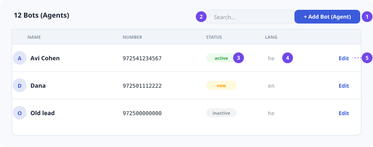

# 04. Adding a bot (agent)

> **These used to be called contacts.** The screens now say **bot (agent)**;
> the URL, the API and the stored fields still say `contact`.

**How to get there:** **Top bar → Phones → click a phone → 👥 Bots (Agents) tab**.

**URL:** `grossman.bot/phones/<phone>/contacts`

The parts in `<angle brackets>` are ids filled in as you click, so this one cannot be opened by typing it.

`…/contacts/new` opens the wizard · `…/contacts/<contact>/edit` edits one.

| # | What it is |
|---|---|
| **1** | Add Bot (Agent) — starts the PING handshake |
| **2** | Search by name or number |
| **3** | The bot (agent)'s state — active, new, draft, inactive |
| **4** | Language used for the PING and the bot's messages |
| **5** | Edit — name, email, language |

## Why this isn't just a form

Adding a bot (agent) is a **handshake**, not a text field. ScenarioBot has to be
certain that the number you typed is the same WhatsApp identity that actually
replies — WhatsApp numbers and WhatsApp identities are not the same thing, and
guessing wrong means messages go to the wrong person.

**Nothing in the product works against an unlinked bot (agent).** Finishing this
properly is the single most important setup step.

## The wizard, step by step

### 1. Name and number

You enter both. The number is checked immediately and you get one of three
answers:

| Answer | Meaning | What to do |
|---|---|---|
| **new** | no bot (agent) for this number | continue |
| **override** | a bot (agent) exists and can be reset | restart the handshake and continue |
| **blocked** | already linked to a real WhatsApp identity | cancel — edit it from the table instead |

The check also reports how far any half-finished handshake got: **pending** (the
PING hasn't gone yet) or **waiting_reply** (it has, and nothing has come back).

### 2. PING

ScenarioBot sends a message from your phone to that number. Nothing for you to
do here.

The message it sends is a **template**, because the person has not written to
you yet and WhatsApp only allows templates for first contact. It picks
`check_contact` — a one-line "Are you a bot?" created with every phone — and
falls back to `hello_world` or any other approved, published template without
placeholders if that one is missing.

**If the phone has no approved, published template at all, the handshake cannot
start.** A new phone gets `check_contact` automatically, so this only comes up
if it was deleted. See [Chapter 08](08-templates.md).

> **A second message goes out with it — not from you.** The platform adds its
> own opt-in notice: that this is automated testing, **your name, your phone
> number and your email**, how to reply STOP, and an unsubscribe link. It is
> sent in English plus the mother tongue of that number's prefix.
>
> If the person uses either one, that number is blocked for the whole
> platform and you cannot undo it. [Chapter 23](23-unwanted.md) is the whole
> story — read it before your first real campaign.

### 3. They reply — and you pick the reply

The wizard polls for incoming replies and lists them as they arrive. **You pick
the one that came from the person you meant.**

Each candidate has a **Chat** button so you can read the full conversation
before choosing.

If the list is empty, the person hasn't replied yet. Press **Refresh**.

Replies are only offered **from the last 24 hours**. A handshake left open for
days will show an empty list even though the person did answer — start it again
rather than waiting.

### 4. PONG

Picking the reply links the bot (agent) to the real WhatsApp identity behind it —
its **LID** — and tags the bot (agent) **active**. This is the step that makes the
bot (agent) usable.

### 5. Summary

Confirm, and the bot (agent) is ready.

## The bot (agent) table

Once linked, bots (agents) appear in a table on the same tab. From there you can edit
a bot (agent), and open its calls.

**Clicking a bot (agent) opens that bot (agent)'s calls** →
[Chapter 10](10-watching-a-call.md) for a running call,
[Chapter 11](11-reading-a-call.md) for finished ones.

> **Two plan rules apply here** ([Chapter 25](25-plans.md)). Only **active**
> bots (agents) count against your plan — and **a bot (agent) you remove
> keeps its slot for 24 hours afterwards**, however it left: deleted, made
> inactive, ignored, STOPped, or a rental that ended. Deleting one to make
> room for another does not work until that time is up, and the banner names
> the hour. It is what stops a one-bot plan being used to message everyone.

## Deactivating, ignoring, restoring

**A bot (agent) is never deleted.** There is no delete — the messages, the PING
records and the history all stay. What changes is the bot (agent)'s **state**, and
every change is stamped with the time it happened.

| State | Where it appears | What it means |
|---|---|---|
| **Active** | the Active section | linked and usable |
| **Not identified** | its own section at the top | created or replied, not linked yet |
| **⏸ Inactive** | the Inactive section, at the bottom | set aside — still visible, can be brought back |
| **🚫 Ignored** | **nowhere** | off the list entirely |

### Inactive

For a bot (agent) you are finished with for now. It keeps its place in the
conversation list:

- the row is **greyed out**, with a **⏸** badge on the avatar and a chip beside
  the name
- it sits in its own **Inactive** section at the bottom, with a count
- the whole history is still there, and opening the row still opens the chat

**Pressing 🔗 Connect on an inactive bot (agent) brings it back.** The dialog says so
when you open it, and completing it returns the bot (agent) to Active.

A number that opted out is the exception: it comes back **⛔ Unwanted** and no
PING can revive it ([Chapter 23](23-unwanted.md)).

A **PING** also revives it — sending a new PING to that number restarts the
handshake from the beginning.

### Ignored

For a number you never want to see again — a wrong number, a stranger who
messaged the bot. An ignored bot (agent) **disappears from the conversation list**
and from the counts. Nothing is deleted; it is simply not shown.

Unlike inactive, there is no button to bring it back, because it isn't on screen
any more. A new PING to that number still revives it.

### Where the buttons are

All three live in the **connect dialog** ([Chapter 12](12-chat-view.md) covers
opening it):

| Button | Does |
|---|---|
| 🔗 **Connect** | links the bot (agent), or brings an inactive one back |
| ⏸ **Cancel** | makes it inactive — it stays under Inactive |
| 🚫 **Ignore** | takes it off the list |

Each asks for confirmation, and the dialog says what it will do before you
press it.

### When the state last changed

Every state change records its time. That is the field to look at when you are
asking "when did this bot (agent) stop working" — it answers directly, rather than
by inference from the last message.

## Common problem

**"I added a bot (agent) but nothing works."** The handshake almost certainly wasn't
finished — step 3 was left open without picking a reply. Reopen the wizard for
that number; you'll get the **Override** answer, and you can complete it.

---

**Next:** [Building a scenario](05-scenarios.md)
