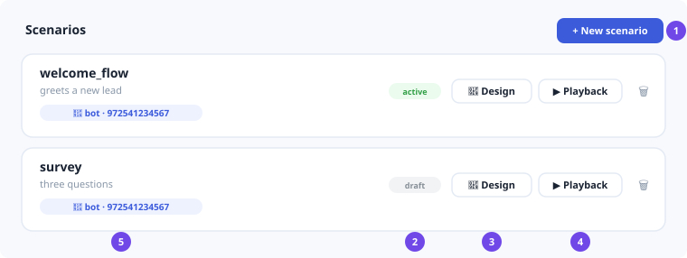
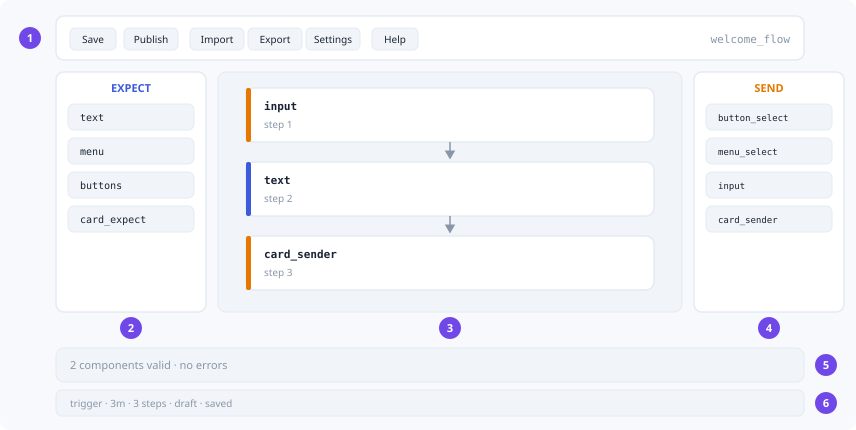

# 05. Building a scenario

**How to get there:** **Top bar → Phones → click a phone → 🤖 Scenarios tab**.
Create a new one, or click an existing one to open the designer.

**URL:** `grossman.bot/phones/<phone>/scenarios`

The parts in `<angle brackets>` are ids filled in as you click, so this one cannot be opened by typing it.

## The three columns

```
EXPECT  |  CANVAS  |  SEND
```

- **CANVAS** in the middle is the conversation, top to bottom.
- **EXPECT** is what the **bot sends and then waits on**.
- **SEND** is what the **reply side supplies**.

That naming reads backwards to most people the first time. The full explanation
and every step type is in [Chapter 06](06-components.md).

A conversation alternates **EXPECT → SEND → EXPECT → SEND** down the canvas.

Drag components onto the canvas and connect them. Works with a mouse and with
touch on a tablet.

## While you work

| Action | How |
|---|---|
| Save | **Ctrl/Cmd + S**, or the save button |
| Undo | **Ctrl/Cmd + Z** — up to 50 steps |
| Redo | **Ctrl/Cmd + Y** or **Ctrl/Cmd + Shift + Z** |
| Duplicate a step | the duplicate action on the step |
| Reorder | drag, or the up/down arrows |
| Export / import | buttons on the ribbon — see below |

An **errors panel** flags problems as you go and pops open by itself whenever
new issues are found.

The two side columns can be **resized, pinned and collapsed**, and your layout
choice is remembered between sessions.



| # | What it is |
|---|---|
| **1** | New scenario — opens the designer empty |
| **2** | draft or active — only an active one runs |
| **3** | Design — opens the canvas |
| **4** | Playback — replay it without sending |
| **5** | The bot contact this scenario talks to |

## The designer



| # | Component | What it is |
|---|---|---|
| **1** | Ribbon | Save, Publish, Import, Export, Settings, Help — and the scenario's name |
| **2** | EXPECT panel | the step types that **wait for a reply** — drag one onto the canvas |
| **3** | Canvas | the conversation itself, top to bottom. A blue edge is an EXPECT step, an amber one a SEND step |
| **4** | SEND panel | the step types that **send something** |
| **5** | Errors panel | what is wrong, and what publishing would reject |
| **6** | Status bar | event type, interval, step count, draft or active, saved or not |

The two panels can be pinned open or left to slide out on hover, and the
preference is remembered between sessions.

## Export and import

**Export** writes the scenario to a `.json` file you can keep, send, or load
onto another phone.

**The templates travel with it.** If any step sends a template, the file carries
the full definition of each one — body, header, footer, buttons, examples — so
the scenario can be rebuilt on a phone that has never seen those templates. If a
template the canvas uses no longer exists on this phone, the export says so and
asks whether to continue without it.

### Importing

**Import** reads such a file and tells you what it will do **before** writing
anything.

**A name that already exists is a conflict, and you choose:**

| Choice | Result |
|---|---|
| **Override** | replaces the existing scenario of that name |
| **New** | creates a separate one, with a free name suggested for you |

**Override turns the scenario back into a draft.** If it was published, it is
unpublished — the new content hasn't been checked yet, so it is not allowed to
keep running. Publish it again once you're happy with it.

### Templates are matched by content, not by file

This is what makes a file portable. For each template the scenario uses:

1. **Already on this phone?** Reused — nothing is created.
2. **Same content in the same language, under any name?** That one is reused. An
   identical template you already approved is not duplicated just because it is
   called something else.
3. **Neither?** It is **created and submitted for approval automatically**, under
   its name from the file. If that name is taken by a different template, a
   number is added — `welcome_2`.
4. **In the file but not valid?** Listed and skipped rather than created.
5. **Not in the file and not on the phone?** Listed as missing — the step will
   have no template, and publishing will tell you.

The preview lists the decision for every template before you commit, so you can
see exactly what is about to be created.

**A template created this way still needs approval.** It goes through the same
submission as one you create by hand. If the provider doesn't approve it
straight away it stays pending — the import still succeeds, and the scenario
simply cannot be published until the template is approved
([Chapter 08](08-templates.md)).

**The file name decides nothing.** The scenario's name is the one in the
designer, and templates are matched by their own content and name. Renaming the
file on disk changes nothing about the import.

### What is not imported

- **The bot contact**, if it belongs to a different phone — contacts are per
  phone, so one from elsewhere is dropped rather than carried over.
- **The publish state** — every import lands as a draft.

## Scenario settings

The **⚙️ settings** button on the ribbon holds everything that applies to the
whole scenario rather than one step:

- description
- **bot contact** — which contact identity the bot presents as
- interval between messages
- estimated duration — set by hand, or calculated automatically
- event type — **scheduler** (started by a schedule) or **trigger** (starts on
  an incoming message)
- priority (default 15) — which scenario wins when several could match

## Saving vs publishing

**Save** keeps it as a draft. A draft can be edited freely and will not run.

**Publish** makes it runnable. Publishing runs three checks first, and is
blocked until all pass:

1. components and their required fields
2. the templates used by scheduler steps
3. custom code compiles — the scenario is compiled on the Worker

When a check fails you get the **list of issues back**, not just a refusal, and
the errors panel shows them. Only after all three pass does the scenario become
active.

Once published, **the save button is disabled** and shows "published". To edit
again, unpublish first.

## Testing before it goes out

- **Playback** reads the scenario back as a chat window →
  [Chapter 07](07-playback.md)
- **Check code** validates a custom-code step against a sandbox →
  [Chapter 06](06-components.md#custom-code-steps)

A real send still needs a real linked contact.

---

**Next:** [Scenario components](06-components.md)
