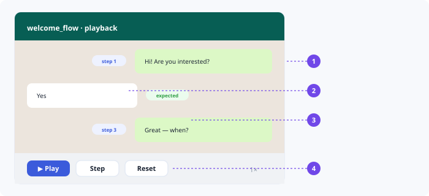

# 07. Playback

**How to get there:** open a scenario in the designer, then the **playback**
action. Or from the **🤖 Scenarios** tab on a phone.

**URL:** `grossman.bot/phones/<phone>/scenarios/<scenario>/playback`

The parts in `<angle brackets>` are ids filled in as you click, so this one cannot be opened by typing it.

| # | What it is |
|---|---|
| **1** | The conversation as it would happen — nothing is sent |
| **2** | Which step produced this message |
| **3** | What the scenario was waiting for |
| **4** | Play, or walk it one step at a time |

## What it is

A scenario replayed as a **chat window** — bot messages on one side, expected
replies on the other — instead of as a diagram.

## Why use it

Reading a flow diagram tells you the structure. Reading a chat tells you how it
will actually feel to the person receiving it. Playback is the fastest way to
catch an awkward sentence, a missing greeting, or two messages that read oddly
back-to-back, before any of it reaches a real person.

## What it doesn't do

It does not send anything and does not create a call. Placeholders show as
placeholders; custom code is not run.

For a real test you need a real linked contact and an actual run.

## Getting back to editing

There's a button to jump straight into the designer for the scenario you're
reading.

---

**Next:** [Templates](08-templates.md)
