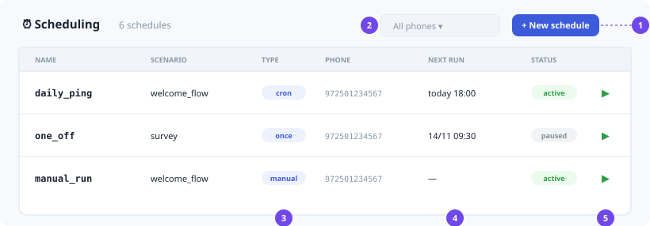

# 09. Schedules

**How to get there:** **Top bar → Schedules.**

**URL:** [grossman.bot/scheduling](https://grossman.bot/scheduling)

Also [grossman.bot/scheduling/new](https://grossman.bot/scheduling/new) to create one, and `grossman.bot/scheduling/<schedule>` for a single schedule.

| # | What it is |
|---|---|
| **1** | New schedule — scenario, phone, when |
| **2** | Filter to one phone |
| **3** | cron, once or manual |
| **4** | When it fires next — the clearest sign it is really set up |
| **5** | Run it now, without waiting |

## What a schedule is

A rule that fires a scenario at chosen times, so you don't have to start each
call by hand.

## Creating one

**Two-step verification is required for a schedule to run.** The screen stays
open and you can set a schedule up, but **nothing will fire** until your mobile
number is verified — the attempt is refused with `TWO_FACTOR_REQUIRED` and the
schedule's log records it. Verify in
[Settings → 🔐](https://grossman.bot/settings/2fa),
[Chapter 14](14-settings.md); the orange banner at the top of the screen is the
shortest route.

A schedule that looks active but never produces a call is the symptom, so check
the banner before anything else.

Create a schedule and choose three things:

1. **the phone** it runs from
2. **the scenario** to run — it must belong to that phone
3. **the timing** — either a one-off time, or a repeating cron expression

**You do not pick the bot (agent).** It comes from the scenario, and is overwritten
whenever you change which scenario the schedule runs.

The scenario must be **published**
([Chapter 05](05-scenarios.md#saving-vs-publishing)) and its bot (agent) must be
**linked** ([Chapter 04](04-contacts.md)), or nothing will run.

## Running one now

**Play** on a schedule runs it immediately — or as close as the system gets. It
queues the schedule for right now and the Scheduler fires it on its next tick,
so it starts **within moments rather than instantly**. A short delay is normal
and not a fault.

If the schedule is already firing, play is refused until it finishes.

A schedule you control is either **active** or **paused**. The other states you
may see — *firing*, *completed*, *error* — are set by the Scheduler itself.

## The log

Each schedule keeps its own log of the calls it produced. That's the place to
check whether last night's run actually happened.

## What can stop a scheduled call

- The phone is **disconnected** → [Chapter 03](03-phones.md)
- The bot (agent) already has a **call running** — only one at a time per bot (agent)
- The scenario was **unpublished** after the schedule was made

All three show up in the schedule's log rather than as an alert, so it's worth
looking there when an expected message didn't go out.

---

**Next:** [Watching a call run](10-watching-a-call.md)
