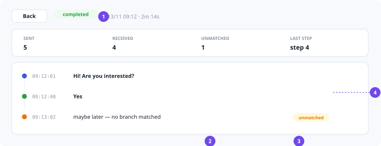

# 11. Reading a finished call

**How to get there:** **Top bar → Phones → a phone → 👥 Contacts → click a
contact.** The list below the live panel is every past call, newest first.

**URL:** `grossman.bot/phones/<phone>/contacts/<contact>/calls/<call>`

The parts in `<angle brackets>` are ids filled in as you click, so this one cannot be opened by typing it.

| # | What it is |
|---|---|
| **1** | How the call ended |
| **2** | Replies that matched no branch — the number to watch |
| **3** | The last step reached — where it stopped |
| **4** | The reply that did not match, and what was expected |

## The list

Each row shows scenario, status, start time, duration, message counts,
mismatches, and whether it was **scheduled ⏰** or **triggered ⚡**.

| Status | Meaning |
|---|---|
| **Completed** | ran to the end |
| **Failed / Error** | a step failed |
| **Aborted** | someone stopped it |
| **Expired / Timeout** | ran out of time waiting for a reply |
| **Running / Pending** | still going |

Filter with the chips along the top. **Both the filter and the paging happen on
the server**, so the counts you see are for the whole history, not just the page
in front of you.

## The flow diagram

Click any row.

The diagram shows the scenario **as it existed when that call ran** — not as it
looks today — with each step coloured:

| Colour | Meaning |
|---|---|
| **green** | done |
| **red** | failed |
| **faded** | never reached, because something earlier failed |

This is why editing a scenario never changes your old reports: each call stores
its own snapshot.

## The events tab

**📡 Events**, beside the diagram, is the raw timeline: every message sent, every
reply received, every timeout and every mismatch, each with a timestamp.

## Using the two together

This pairing is the point of the product.

- **The diagram tells you *where* it broke.**
- **The events tell you *what actually arrived*.**

The most common finding: the reply is right there in the events, but the step
still failed — which means the EXPECT step's match mode was too strict. See
[Chapter 06](06-components.md#match-mode).

---

**Next:** [The chat view](12-chat-view.md)
