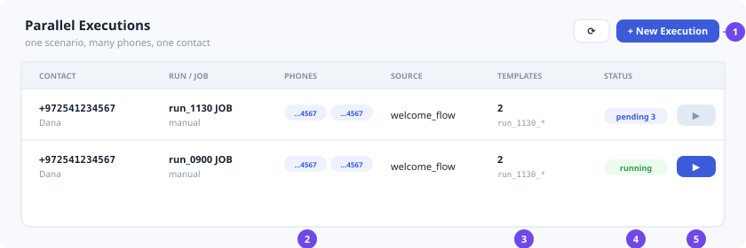

# 13. Parallel executions

**How to get there:** **Top bar → Executions.**

**URL:** [grossman.bot/executions](https://grossman.bot/executions)

Also [grossman.bot/executions/new](https://grossman.bot/executions/new) for the
wizard, and `grossman.bot/executions/<execution>/run` for the run confirmation.

| # | What it is |
|---|---|
| **1** | New Execution — the four-step wizard |
| **2** | The target phones — first two, then +n |
| **3** | How many templates were copied, and their prefix |
| **4** | pending n = the Scheduler has not picked the jobs up yet |
| **5** | Run — disabled while anything is pending |

> **Parallel executions are a plan feature.** On a plan without them the
> section is not in the top bar at all ([Chapter 25](25-plans.md)).

## What it is

One scenario, **copied onto several phones**, all talking to the **same
bot (agent)**. Instead of building the same conversation by hand on every phone, you
pick a scenario that already works on one phone and the platform reproduces it
on the others.

That is the whole idea: a **source** scenario on one phone, duplicated to as
many **target** phones as you choose, each against the one bot (agent) you name.

### What actually gets created

For every target phone, three things are copied, and the names are predictable
on purpose:

| Copied | Named | Example |
|---|---|---|
| the scenario | `{run name} {scenario}` | `run_20261025_1130 Welcome flow` |
| each template it uses | `{prefix}_{template}` | `run_20261025_1130_check_contact` |
| a schedule to fire it | `{run name} JOB`, **manual** | `run_20261025_1130 JOB` |

So a run against five phones using two templates creates five scenarios, ten
templates and five schedules. The summary step counts it all out before you
commit, which is the moment to notice a number that looks wrong.

The schedules are **manual** — they never fire on a timer. The ▶ button on the
execution is what runs them, all of them, in parallel.

## Creating one — the wizard

**＋ New** opens a four-step wizard at
[/executions/new](https://grossman.bot/executions/new).

### Step 1 — the bot (agent)

Type a name or a number and pick from the list. The search covers **your active
bots (agents)** across all your phones, and it behaves differently depending on what
you type:

| You type | You get |
|---|---|
| nothing | the bots (agents) linked on the **most** phones first |
| digits | matches by number |
| text | matches by name |

Each result shows how many of your phones that bot (agent) is already linked on —
that count is the useful one, because those are the phones the run can use.

The number must be in international form without a plus: **`972` followed by
8–10 digits**. Picking from the list fills it in correctly, so typing by hand is
the slow path. Enter moves on.

### Step 2 — the target phones

The bot (agent)'s card appears with the phones it is linked on. Tick the ones to run
against.

**Only linked phones (Baileys) can be targets.** A Cloud API phone is shown but
cannot be ticked, and hovering it says why. Cloud API templates live on the
business account rather than on the phone, so the per-phone template copying
this feature relies on has nothing to copy to.

A phone that is linked to the bot (agent) but **disconnected** can still be ticked —
its status is shown in amber. It will not run until it is back.

### Step 3 — the source

Two choices, in order:

1. **The source phone** — your phones, each showing how many scenarios it has.
2. **The scenario** — that phone's scenarios, with their descriptions.

Picking a scenario lists the **templates it uses**. That list is what the prefix
in the next step will be applied to, so if it is empty, no templates will be
copied — which is fine for a scenario that only sends free text.

### Step 4 — names and the summary

| Field | Notes |
|---|---|
| **Run name** | free text, up to 80 characters. Left empty, it is filled with `run_<date>_<time>` |
| **Template prefix** | derived from the run name automatically — lowercase, letters, digits and `_` |

The prefix follows the run name as you type it, **until you edit the prefix
yourself**; after that it is yours and stops being overwritten. It must start
with a letter and may hold only `a-z`, `0-9` and `_`. An invalid prefix outlines
the field in red and blocks the finish button.

The summary beneath lists the bot (agent), the source, every target phone, and the
exact names of every scenario, template and job that is about to be created.
**Read it.** This is the step where "five phones" rather than "two" is cheap to
notice.

**✔ Create** builds everything. It does not run anything.

## The list

One row per execution:

| Column | Shows |
|---|---|
| **Bot (Agent)** | the number the run talks to, and the bot (agent)'s name |
| **Job** | the schedule name, and `manual` beneath it |
| **Phones** | the first two target numbers, then `+n` |
| **Source** | the scenario that was copied, and the phone it came from |
| **Templates** | how many were copied, and the prefix as `prefix_*` |
| **Last run** | when it last fired |
| **Status** | the run's state, or **pending n** |

### Pending

**Pending** means the jobs are queued and the Scheduler has not picked them up
yet. While anything is pending, the screen **refreshes itself every five
seconds** and the ▶ button is disabled — you cannot start a run that is already
starting.

This is the normal state for the first few seconds after ▶. If it stays pending
for much longer, the Scheduler is the thing to check.

## Running one

▶ **Run** opens a confirmation listing the job name, the bot (agent) and how many
phones are about to be used. Nothing is sent until you confirm.

The confirmation has its own address, `/executions/<execution>/run`, so it
survives a refresh — and if the execution has since been deleted, you are
returned to the list rather than left looking at a dialog for something that no
longer exists.

| Button | Does |
|---|---|
| ▶ **Run** | fires every target phone's job, in parallel |
| ⏸ | stops a run in progress |
| 🗑 | deletes the execution — asks first |

## Worth knowing

**The one-call-per-bot (agent) rule still applies.** Many phones calling one bot (agent)
at once is exactly what this feature is for and is allowed. The same *phone*
calling the same bot (agent) twice at once is not, and the second attempt is
refused.

**Deleting an execution** removes the execution, not the scenarios, templates and
schedules it created. Those were made on the target phones and stay there — which
is why the naming matters: `run_<name> …` is how you find them later.

**Templates still need approval.** The copies are created as drafts like any
other template, and a copy that has not been approved yet will not send
([Chapter 08](08-templates.md)).

---

**Next:** [Settings and account](14-settings.md)
