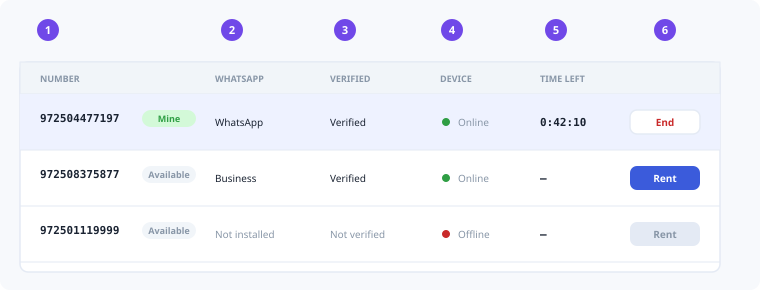

# 20. Renting a phone

**How to get there:** **Top bar → Rented phones.**

**URL:** [grossman.bot/rent](https://grossman.bot/rent)

> **The tab only appears after two-step verification**, like the API console.
> Until your mobile is verified there is no Rented phones button, and `/rent`
> sends you back to the phone list — see [Chapter 14](14-settings.md).

## What it is

A pool of **real phones with real SIM cards**, sitting on a rack and connected
to the platform. You rent one for a while, it becomes yours, and when the time
is up it goes back to the pool.

The difference from a phone you add yourself ([Chapter 03](03-phones.md)) is
simply whose handset it is. Once rented it behaves like any other phone — the
same contacts, scenarios, schedules and templates — **plus** an SMS tab, because
a rented phone has a SIM that receives text messages
([Chapter 21](21-sms.md)).

That is what makes it useful for testing: you get a working number with a real
WhatsApp registration, without buying a SIM.

## The list

| # | Column | Shows |
|---|---|---|
| **1** | Number | the phone's number, and a **Mine** or **Available** chip |
| **2** | WhatsApp | WhatsApp, Business, or *Not installed* |
| **3** | Verified | whether the link to the handset is live, and when it was checked |
| **4** | Device | green dot = the handset is online, red = unplugged |
| **5** | Time left | your rental's countdown, ticking every second |
| **6** | Action | **Rent** on an available row, **End** on yours |

Your own rentals are highlighted and listed first. A greyed-out **Rent** means
the row cannot be rented — see below.

The list refreshes itself every half a minute, so a phone someone else takes
disappears without you reloading.

**Search** filters by number.

## Renting one

Press **Rent** on an available row. A dialog tells you how long you get —
**free of charge** — and what it means:

> The phone is handed over clean (setup templates are kept). When the time is up
> it returns to the pool and everything created on it is deleted.

Press **Start** and the phone is yours. It appears in your phone list straight
away.

**Rent is disabled when:**

| Reason | What to do |
|---|---|
| the device is **offline** | wait — the handset is unplugged or the rack is down |
| **WhatsApp is not installed** on that SIM | pick another number; nothing can run on it |
| another action is still running | wait a second |

The rental length is a platform setting, usually an hour. It is the same for
everyone and cannot be extended from this screen.

## While it is yours

The phone is a normal phone:

- it is in **Phones**, with its own contacts, scenarios and schedules
- it has an extra **SMS** tab ([Chapter 21](21-sms.md))

### How it looks in the phone list

A rented phone is marked twice, so you never confuse it with one of your own:

**A green-and-white striped frame** around the whole card — the hire-plate look.
It is there for as long as the rental lasts and disappears when it ends.

**A 🔋 battery gauge** next to the signal bars, which **drains as your time
runs out**:

| Battery | Means |
|---|---|
| green, over half full | plenty of time |
| amber | under half |
| **red** | the last stretch — the same moment you get the warning notification |

The remaining time is printed beside it and ticks every second. The phone's own
screen shows the same countdown next to its name.

A draining battery is a better signal than a number: you read it without
thinking, which is the point when the thing it measures is destructive.

## You get told three times

Rentals are the one thing in the platform that **deletes your work on a timer**,
so there are three notifications in the bell
([Chapter 14](14-settings.md#notifications)):

| When | Level | Says |
|---|---|---|
| you rent it | ℹ️ info | the rental started, and when it ends |
| part-way through | ⚠️ warning | *Rental ending soon* — with the end time |
| at the end | ❌ error | *Rental ended* — the phone went back and its data is gone |

The warning comes at a **proportion of the rental**, not a fixed number of
minutes before the end. At the usual 80%, an hour's rental warns you with twelve
minutes left — and a three-minute rental warns you with thirty-six seconds.
Short rentals give short warning.

All three are in your own language, with the time in your own timezone.

> **If you have "Errors only" switched on for email, the warning will not
> reach your inbox** — only the *ended* one does, because it is the only one
> logged as an error. The bell shows all three either way. If you want the
> advance warning by mail, turn **Errors only** off in
> [Settings → ⚙️ Advanced](https://grossman.bot/settings/advanced).

The end-of-rental notification **cannot be clicked through to the phone**, which
is correct — by then it isn't yours.

**You cannot delete a rented phone.** Deleting is for phones you added; a rented
one is ended, not deleted — the handset stays in the pool for the next person.

## Ending it

**End** on your row, or let the clock run out. Either way the same thing
happens, and the confirmation says it plainly:

> Everything on the phone (contacts, calls, scenarios, SMS) will be deleted.

**Take anything you want to keep before the time runs out.** A scenario you
built on a rented phone is gone when the rental ends — export it first
([Chapter 05](05-scenarios.md#export-and-import)) and import it onto a phone of
your own.

What survives the wipe is only the **setup templates** — the ones every phone
starts with — so the next renter gets a working phone rather than an empty one.

Expiry is swept on the server every half a minute or so, so a phone may show
*Ended* for a few seconds before it reappears as available. The sweep is also
what sends the notification, so the bell and the list agree.

## Worth knowing

**It is a shared pool.** Someone else may take the number you were looking at.
The list refreshing under you is that, not a glitch.

**The number is real and so is its history.** It was registered on WhatsApp like
any other number, and the SMS tab shows whatever arrives on it — including
messages meant for whoever used it before you.

**Verification is about the link, not about you.** The *Verified* column tells
you the platform's connection to that handset is live. A number that is not
verified will not send, and the rack operator is the one who fixes it.

---

**Next:** [SMS on a rented phone](21-sms.md)
