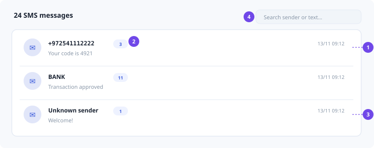

# 21. SMS on a rented phone

**How to get there:** **Top bar → Phones → a rented phone → ✉️ SMS tab.**

**URL:** `grossman.bot/phones/<phone>/sms`

The part in `<angle brackets>` is an id filled in as you click, so this one
cannot be opened by typing it.

> **The tab exists only on a rented phone** ([Chapter 20](20-rented-phones.md)).
> A phone you added yourself has no SIM the platform can read, so there is
> nothing to show. Opening the `sms` address on such a phone lands on Calls.

| # | What it is |
|---|---|
| **1** | One row per sender — tap to open the conversation |
| **2** | How many messages from that sender |
| **3** | Messages with no readable sender land here |
| **4** | Search covers the sender and the text |

## What it is

The **text messages that arrived on the phone's SIM** — not WhatsApp messages.
Ordinary SMS, the kind a bank or a delivery company sends.

This is what makes a rented phone useful for testing a sign-up flow: the
verification code that an outside service texts to the number shows up here.

**Incoming only.** You cannot send an SMS from this screen.

## The list

One row per **sender**, most recent first:

| Part of the row | Shows |
|---|---|
| the number | who sent it, or *Unknown sender* |
| the badge | how many messages from them |
| the time | when the last one arrived |
| the grey line | the start of that last message |

**Search** covers both the sender and the message text, so looking for the word
in a code works as well as looking for the number it came from.

Messages with no identifiable sender are grouped under **Unknown sender** rather
than dropped.

The list refreshes itself every 15 seconds.

## Reading a conversation

Clicking a row opens the messages from that sender.

- it **opens at the newest message**, like a chat
- **scroll up for older ones** — they load as you reach the top
- new messages arrive on their own while it is open, and the view follows them
  **only if you were already at the bottom**, so reading older ones is not
  interrupted
- dates separate the days
- **Start of conversation** at the top means there are no older messages

**Esc** or a click outside closes it.

## When a message doesn't arrive

In order of likelihood:

| Cause | What you would see |
|---|---|
| the handset is **offline** | the phone shows as offline in the rent list |
| the message went to **the other SIM** | it belongs to a different number — check which number you rented |
| the sender is blocked by the carrier | nothing arrives, and nothing is logged |

Delivery is not instant. Messages come through the rack and are forwarded on a
short retry cycle, so a few seconds is normal; a minute is not.

**Messages are not deleted when they arrive** — they stay on the phone for as
long as your rental lasts, and go when it ends, along with everything else
([Chapter 20](20-rented-phones.md#ending-it)).

## Worth knowing

**You may see somebody else's messages.** The SIM existed before your rental and
a sender does not know the number changed hands. Treat anything from before your
rental as not yours.

**This is a different thing from the chat view.** [Chapter 12](12-chat-view.md)
is the WhatsApp conversation with a bot (agent). This tab is the SIM's text
messages. The two never mix, and a WhatsApp message will never appear here.

---

**Next:** [Troubleshooting](16-troubleshooting.md)
