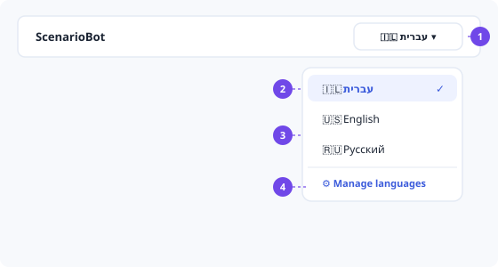
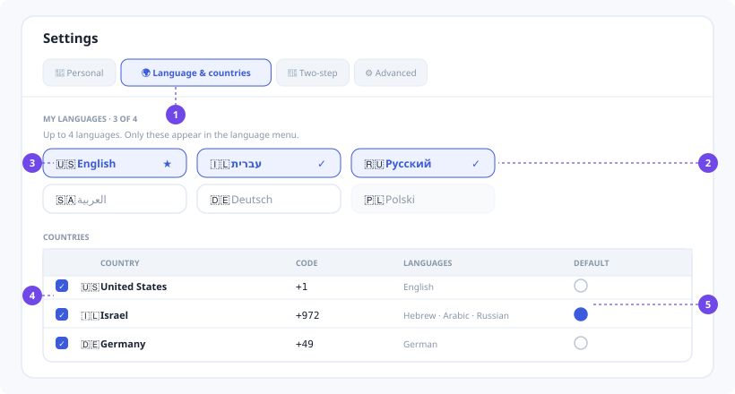

# 22. Languages and countries

**How to get there:** the **🌐 flag in the top bar** switches language.
**Top bar → ⚙️ Settings → 🌍 Language & countries** decides which languages
are in that menu and which countries appear in phone fields.

**URL:** [`grossman.bot/settings/locale`](https://grossman.bot/settings/locale)

| # | What it is |
|---|---|
| **1** | The flag and name of the language you are reading now |
| **2** | A tick marks the current one |
| **3** | Your languages — only the ones you chose in Settings |
| **4** | **Manage languages** opens the settings tab below |

## Two different things

People mix these up, so the distinction is worth stating once:

| | What it controls |
|---|---|
| **Language** | the words **you** read — buttons, menus, errors |
| **Country** | which **dial codes** appear in phone fields, and which language the platform offers a *recipient* |

Changing your language does **not** change what your bots (agents) receive.
A bot (agent) in Israel is written to in Hebrew whichever language you read the
interface in.

## Changing the language

Click the **🌐 flag**, pick a language. It applies immediately — no save, no
reload — and it is remembered for your account, so the next sign-in on another
machine comes back in the same language.

**Hebrew and Arabic flip the whole layout** right-to-left: the menu moves, the
tabs reverse, text aligns to the right. That is intended. Switching back to
English or Russian flips it back.

The first time you open a language it is fetched from the server and kept in
your browser, so later switches are instant and work offline.

## Your languages

| # | What it is |
|---|---|
| **1** | The 🌍 tab |
| **2** | Every language the platform offers — click to add or remove |
| **3** | ★ marks the interface language; it can't be removed |
| **4** | The countries table |
| **5** | The default country for a new phone field |

The 🌐 menu does not list every language the platform has — it lists **the ones
you chose**, up to **four**. The idea is that the menu stays short enough to be
useful.

- Click a language to **add** it; click again to **remove** it.
- The language you are currently reading is marked **★** and cannot be removed —
  switch away first.
- At four, the rest grey out. Remove one to make room.

**Removing a language doesn't delete anything.** It only leaves your menu, and
its copy is dropped from your browser.

### Which languages exist

Each language carries a **phase**: phase 1 is complete and reviewed, higher
phases are newer. A language only appears here once it is enabled
platform-wide, so what you see is already translated.

**A missing translation falls back to English** — one string at a time, not the
whole screen. So an occasional English label among translated ones is a gap in
that language, not a bug in your account. It is worth reporting; it is fixed
centrally and arrives without an update on your side.

## Countries

The countries table decides **which dial codes you can pick in a phone field** —
when adding a phone, adding a bot (agent), or anywhere a number is typed.

| Column | What it does |
|---|---|
| the tick | include this country in phone fields |
| **Country** | name and flag |
| **Code** | the dial code, e.g. `+972` |
| **Languages** | the languages spoken there |
| **Default** | the one pre-selected in an empty phone field |

**At least one country must stay selected.** Clearing them all is refused and
the tab is flagged, because a phone field with no country can't validate a
number.

**The default country also changes how typing behaves.** With Israel as the
default, typing `0501234567` is understood as a local number and the leading
`0` is dropped — the number is stored as `972501234567`. Typing a number that
starts with another country's code is recognised on its own.

Each country knows how many digits a valid number has, so a number that is too
short or too long is caught in the field rather than at send time.

## Mother tongue — what the recipient gets

Every country has **one mother tongue**: Israel → Hebrew, Germany → German,
the United States and the United Kingdom → English.

This matters in exactly one place, and it is not about you: the platform's own
messages to an outside number — **the first PING message** and the
**unsubscribe confirmation** ([Chapter 23](23-unwanted.md)) — are sent in
**English plus the mother tongue of that number's prefix**. A number starting
`+972` is written to in English and Hebrew; `+49` in English and German.

If the prefix belongs to no enabled country, or its mother tongue is English,
the message is English only.

## When you are not signed in

The sign-in and landing pages also have the 🌐 menu, with two entries: English,
and the mother tongue of **the country you appear to be in** — worked out from
your connection, not from anything you typed.

If that cannot be determined, English. Nothing breaks either way, and your own
choice replaces the guess as soon as you sign in.

## Common questions

**I changed language and one screen is still in English.**
That string has no translation in that language yet. Report it — the fix is
central and you will get it without doing anything.

**A colleague sees the app in a different language.**
The choice is per account, not per company.

**I can't find my country in a phone field.**
It isn't selected in the 🌍 tab, or the platform hasn't enabled it yet. Select
it there first.

**The layout is mirrored.**
Hebrew or Arabic is the interface language. Switch to English or Russian.

**A bot (agent) got a message in the wrong language.**
That follows the *number's* prefix, not your interface language — see
*Mother tongue* above.

---

**Next:** [When someone asks to stop](23-unwanted.md)
