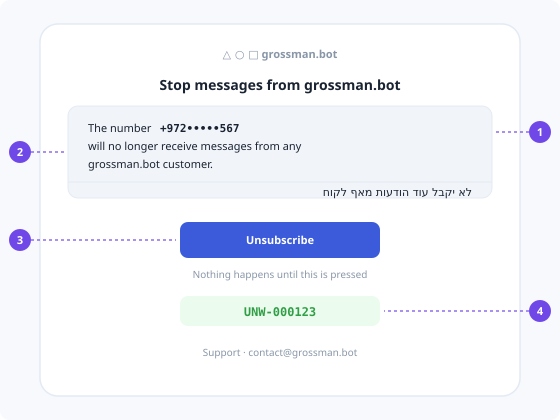

# 23. When someone asks to stop — unwanted

**How to get there:** you don't go to it — it arrives. A bot (agent) that asked
to stop is marked **⛔ Unwanted** in **Phones → a phone → 📞 Calls**.

**URL:** `grossman.bot/phones/<phone>/calls`

> **This one is not reversible from the interface.** No button, no admin
> screen, no API call. Only support can undo it, and only after checking.
> That is deliberate — see [Why it is this strict](#why-it-is-this-strict).

## What it is

Every number the platform writes to for the first time gets a message saying
who is testing and how to stop. If that person says stop, their number is
**blocked across the whole platform** — for you and for every other
grossman.bot customer, forever, on every phone.

Two ways they can say it:

| They… | What happens |
|---|---|
| **reply STOP** to the first message | blocked, and a confirmation is sent back |
| **open the unsubscribe link** in that message and confirm | the same |

## The first message

The first message to a new number isn't your scenario. It is a fixed opt-in
message the platform sends, and it carries:

- that this is an automated message for **messaging-system testing**
- **who is testing** — your name, your phone's number, your email
- **reply STOP**, with a time limit
- **an unsubscribe link** that never expires
- grossman.bot support — email and phone

It goes out in **English plus the mother tongue of the number's prefix**
([Chapter 22](22-languages.md)). Your own interface language has nothing to do
with it.

**Your details are in it on purpose.** The recipient gets a real party to
complain to rather than an anonymous number, which is what keeps the platform's
numbers usable.

## STOP has a window — the link does not

A **STOP reply only counts within a set number of minutes of the first
message** (an hour by default). Later, the word is just a word: someone writing
"stop by tomorrow" three days into a conversation is not opting out.

Matching is strict. The whole message has to be the stop word, give or take
punctuation, in any of the languages the platform knows — `stop`,
`unsubscribe`, `cancel`, `הסר`, `עצור`, `стоп`, `توقف`, and others.

**The unsubscribe link never expires.** A month later it still works. That is
the escape hatch that lets the STOP rule stay narrow.

When it is genuinely unclear which number a STOP came from, **it is ignored**
and logged. Blocking the wrong person is worse than missing one STOP, and the
link still works.

## The unsubscribe page

| # | What it is |
|---|---|
| **1** | The number, partly masked |
| **2** | Each block in its own language and direction |
| **3** | Nothing happens until this is clicked |
| **4** | The reference number to quote to support |

This page is for **the recipient**, not for you. It is public — no sign-in.

**Opening it does nothing.** Blocking happens only when the button is pressed,
so a WhatsApp link preview, a mail scanner or a curious click can't opt anyone
out by accident.

Afterwards the page shows a **reference number** like `UNW-000123`, and the
same reference is sent back as a WhatsApp message. That reference is what
support needs if it ever has to be undone.

## What you see

In the conversation list the bot (agent) keeps its row and turns red:

- a **⛔ Unwanted** tag next to the name
- the row dimmed
- **no Connect button**

Opening the chat shows a red banner: *This number asked not to receive
messages*, and underneath, that it replied STOP or used the link and that
sending is blocked for every grossman.bot customer.

**The composer is gone.** Not disabled with a tooltip — removed. There is no
path to sending, including templates.

**The history stays.** Nothing is deleted. You can read everything that was
said before.

## It applies everywhere, and it sticks

The block lives on the **number**, not on your copy of it.

- every one of your phones
- **every other customer's** phones
- any bot (agent) created later with that number — it is marked ⛔ the moment it
  is created
- a draft row created when that person messages one of your phones

That last one matters: it is enforced in the database, not in the app, so no
screen, import, wizard or API call can produce a sendable bot (agent) for a
blocked number. The platform also remembers the person's WhatsApp internal id,
so a message arriving without the number attached is caught too.

Scenarios and schedules aimed at that bot (agent) simply have nothing to send
to.

## Why it is this strict

WhatsApp bans numbers that message people who asked them not to. One complaint
can take out a phone; a pattern can take out every phone on the platform.

So the block is in the database rather than in the app, it covers all customers
rather than just the one who sent the message, and nobody can clear it from the
interface. The cost of a wrong block is one annoyed contact. The cost of
ignoring a STOP is a dead number.

## Getting it undone

Contact support with the **reference number** (`UNW-…`) or the number itself.
Support can revoke it, and only then.

When revoked, the bot (agent) comes back as **inactive** — not active. You
reconnect it as you would any inactive one ([Chapter 04](04-contacts.md)), which
means the handshake runs again and the person gets the opt-in message again.

## Common questions

**Can I undo it myself?** No. Support only.

**Did my scenario send the first message?** No. The platform did, before your
scenario, automatically.

**Someone replied "stop sending me these" — why is nothing blocked?**
Only the bare stop word counts. The link in the first message is how they do it
in their own words.

**They opted out from another customer's phone. Why is my bot (agent) blocked?**
The block is on the number, platform-wide. That is what it means.

**My ⛔ bot (agent) has a scenario and a schedule on it.** They stay, and send
nothing. Point them at a different bot (agent).

**Can I delete the bot (agent) and start over?** You can delete it, and a new
one with that number comes back ⛔ immediately.

---

**Next:** [Troubleshooting](16-troubleshooting.md)
