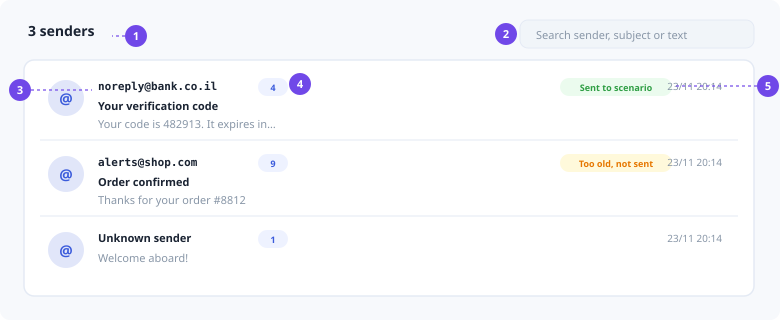

# 24. Mail — every phone has an email address

**How to get there:** **Phones → a phone → 📧 Mail**. The address itself is on
**Phone details**, the button on the phone's card.

**URL:** `grossman.bot/phones/<phone>/mail`

## The address

Every phone has its own inbox, named after its number:

```
972504476645@grossmanbot.download
```

The digits of the phone's number, then `@grossmanbot.download`. Nothing to set
up — it is created for you, and **Phone details** shows it with a Copy button.

A new phone's address can take **a few minutes** to start working; until then
the dialog says so. Mail sent before that is lost, so copy it and send a test.

**Unlike SMS, this is on every phone** — rented or not, Cloud API or linked.
[SMS](21-sms.md) needs a rented handset with a real SIM; mail doesn't.

## What it is for

A scenario can **wait for an email and pull a code out of it**.

That is the whole point. Plenty of services send their verification code to an
email rather than by SMS, and this lets a scenario sign in to one, read the
code and carry on — without a person watching a mailbox.

Two cards in the designer do it ([Chapter 06](06-components.md)):

| Card | Does |
|---|---|
| **📧 Receive mail** | waits for a mail, and captures a value out of it |
| **✉️ Send mail code** | sends what was captured on to WhatsApp |

## The Mail tab



| # | What it is |
|---|---|
| **1** | How many senders have written |
| **2** | Search — sender, subject and body text |
| **3** | One row per **sender**, not per message |
| **4** | How many mails that sender has sent |
| **5** | Whether the scenario got it |

The list groups by sender, newest first, and refreshes by itself every few
seconds. Click a row to read that sender's mail, newest at the bottom; scroll
up to load older ones.

### The status on each mail

| | What it means |
|---|---|
| **Sent to scenario** | it reached a running scenario |
| **Too old, not sent** | it arrived more than ten minutes after it was sent — a verification code that stale is no use, so it is kept but not delivered |
| **Phone has no host** | the phone isn't running; reconnect it |
| **Not delivered** | it reached the platform but not the phone — worth reporting |

**No status at all is normal.** It means nothing was waiting for it. Mail is
only pushed into a scenario that is sitting on a **Receive mail** card; the
rest is just stored for you to read.

## Using it in a scenario

1. Add **📧 Receive mail** where the scenario should wait.
2. Narrow it down, if you want — **who sends** (`noreply@bank.co.il`, or
   `@bank.co.il` for the whole domain) and **which subject**. Leave both empty
   and any mail is accepted.
3. Choose **what to capture**: `6 digits`, `4 digits`, `3+3 digits`, a `Link`,
   a `Format` like `Your code is <?>`, or a regex.
4. Add **✉️ Send mail code** after it to send the captured value on.

There's a **Test** box in the card — paste a real sender, subject and body and
it tells you straight away whether the value would be captured, and if not,
which part didn't match.

**The wait is counted from the last message the scenario sent**, not from when
the card is reached. So the clock starts when you trigger the thing that
causes the mail.

### Worth knowing

**Sender and subject ignore upper and lower case.** `Match case` only applies
to the Format and Regex captures, and it is off by default.

**The mail can arrive before the scenario asks for it.** A mail that lands up
to ten minutes early is still matched when the card is reached — services often
send the code faster than the scenario gets there.

**Only one value is captured.** With a Format, exactly one `<?>`. With a regex,
group 1 — any further groups land in `MailParam01`, `MailParam02` and so on.

## Mail is per phone, and it does not outlive a rental

The mailbox belongs to the phone. If a **rented** phone goes back to the pool
or is rented by someone else, **every mail it received is deleted** and the
address moves to the new owner. The address itself doesn't change — it is the
phone's number.

So don't use the Mail tab as an archive. Anything you need, copy out.

## When something doesn't arrive

**Nothing in the tab at all.** Check the address on **Phone details** against
what you actually sent to — the address is the phone's number, so a typo is
easy. If the phone is new, give it a few minutes.

**It is in the tab but the scenario didn't get it.** Read the status on the
message. *Too old* means it took more than ten minutes to reach us. No status
means nothing was waiting — the scenario wasn't on a **Receive mail** card,
usually because an earlier step was still waiting or the call had already
ended.

**It arrived but nothing was captured.** Use the **Test** box with the real
mail. It names the part that failed: the sender, the subject, or the value.

---

**Next:** [Scenario components](06-components.md) · [SMS](21-sms.md)
