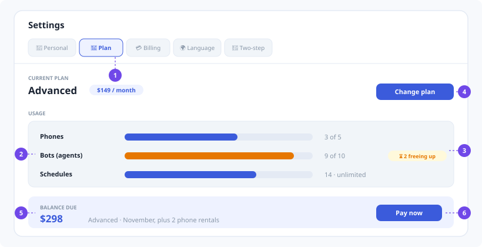

# 25. Your plan, your limits and the bill

**How to get there:** the **💎 badge in the top bar** shows your plan and opens
the plan picker. **Settings → 💎 Plan** and **Settings → 💳 Billing** are the
full versions.

**URL:** [`grossman.bot/settings/plan`](https://grossman.bot/settings/plan) ·
[`grossman.bot/settings/billing`](https://grossman.bot/settings/billing)

| # | What it is |
|---|---|
| **1** | The 💎 tab — 💳 Billing is next to it |
| **2** | What you are using against what the plan allows |
| **3** | Slots freeing up — not free yet |
| **4** | **Change plan** |
| **5** | What you owe: charges minus payments |
| **6** | **Pay now** — the whole balance |

## What a plan limits

Three things are counted, and one thing is unlocked:

| | What it counts |
|---|---|
| **Phones** | the phones you added. **Rented phones don't count** ([Chapter 20](20-rented-phones.md)) — they are billed by the hour instead |
| **Bots (agents)** | every **active** bot (agent), across all your phones together |
| **Schedules** | your schedules, not counting finished ones |
| **API · Parallel executions** | on or off, by plan, rather than counted |

`∞` means no limit on that plan.

**Only active bots (agents) count.** One that is inactive, ignored or ⛔
Unwanted is not using a slot — see the cooldown below for the catch.

## When you hit a limit

The add button stops working and a banner says why. There are three of them and
they are not the same thing:

**💎 Plan limit reached.** You are at the plan's number. Upgrade, or remove one
of what you have.

**⏳ Wait before adding a new bot (agent).** This one surprises people:
**a bot (agent) you removed keeps its slot for 24 hours.** Deleting one and
adding another immediately does not work, and the banner tells you the time
it frees up.

That is deliberate. Without it, one plan with one bot slot could message an
unlimited number of people — add, send, delete, repeat. The wait is what stops
a small plan being turned into a bulk sender. **It applies however the bot
(agent) left**: you deleted it, you made it inactive, it was ignored, the person
replied STOP, or a rental ended.

**💎 Not included in your plan.** A whole feature — the API console, parallel
executions — rather than a count. Upgrading is the only way.

> **The limit is enforced on the server, not in the screen.** Hiding a button is
> a courtesy; the request is refused either way. Going around the UI with the
> API gets you the same `409`.

## Changing plan

Click **💎**, pick a plan, confirm. It takes effect immediately.

**Downgrading never deletes anything.** If you have five phones and move to a
plan that allows two, you keep all five — you simply cannot add a sixth until
you are under the limit. The dialog warns you first and lists what you are over
on.

### What you actually get charged

The rule is in your favour, and it is worth knowing before you time an upgrade:

> **You always pay the lower of the two prices** — what the plan cost when your
> month started (or when you switched to it, if that was later), and what it
> costs today.

So a price rise does not apply to a month already running; a price cut applies
straight away.

**But within one month, the most expensive plan you were on is what you pay.**
Upgrading for three days and dropping back still bills that month as the
upgrade. There is no proration — think in whole months.

## The bill

**You are not charged when you act. You accrue a balance, and pay it when you
choose.** Nothing is blocked while a balance is outstanding.

**Settings → 💳 Billing** shows:

- the **balance due** — everything charged, minus everything paid
- **by month** — one row per month, each opening to show the plan charge and
  every phone rental in it
- each month marked **Paid**, **Partly paid** or **Due**
- the **payments** you have made

**Payments are applied oldest month first**, which is why a single payment can
leave one month `Paid` and the next `Partly paid`.

### Paying

**Pay now** sends you to CardCom's payment page for the whole balance, and
brings you back here. Tick **Save my card for next time** and the card is kept
by CardCom — **the platform never holds your card number**, only the last four
digits and the expiry, which is what the Payment method box shows.

A payment is only marked paid once the platform has confirmed it with CardCom
directly. If you land back with a failure, **nothing was charged**.

If you see *"Online payment is not available yet"*, card payment isn't switched
on yet. Your balance keeps accruing correctly and is waiting for you.

## Renting a phone

Rentals are **not** part of the plan's phone count — they are priced per
duration and added to the same balance ([Chapter 20](20-rented-phones.md)).

The rental dialog shows the price next to each duration, and:

- **Free** — that duration is set to zero; nothing is charged
- **{price} is added to your balance** — it joins the current month's bill
- **not available right now** — no durations are on offer at the moment

**The price is fixed when you book.** If the rate goes up during your rental,
you keep the price you booked at; if it goes down, you get the lower one.

## Common questions

**Do rented phones use up my phone limit?** No. They are billed by the hour
instead.

**I deleted a bot (agent) and still can't add one.** The 24-hour wait. The
banner gives the exact time.

**I downgraded — did I lose anything?** No. You keep what you have and cannot
add more until you are under the new limit.

**Why is this month more than the plan price?** Open the month in 💳 Billing —
phone rentals are charged into the same month, each listed separately.

**I was charged for a plan I only had for a few days.** A month is billed at
the most expensive plan that was active in it. There is no proration.

**Can I get an invoice?** The by-month breakdown is the record. For a formal
invoice, write to **contact@grossman.bot**.

---

**Next:** [Settings](14-settings.md) · [Renting a phone](20-rented-phones.md)
