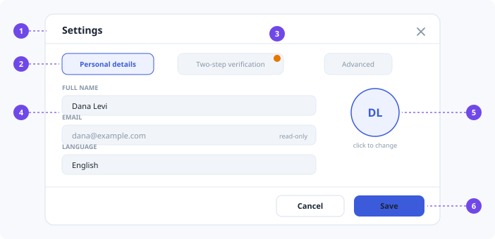

# Screen diagrams

Hand-built SVG, one per screen, drawn from the real component code — the
colours are `src/theme.js`, the layout is the JSX.

They are **not screenshots**, on purpose:

- they do not go stale when a label moves three pixels
- they stay legible at any width, and in dark mode
- they are text, so a diff shows what changed
- **every element carries an `id`**, so a chapter, a support reply or a script
  can point at one part of a screen: `screen-settings.svg#settings-tab-2fa`

## Using one in a chapter

```markdown


| # | Component | What it is |
|---|---|---|
| **1** | Title bar | … |
```

The numbered purple badges in the drawing match the first column of the table
under it. Keep that pairing — it is what makes the picture answerable by a chat
assistant reading one chapter.

## The set

| File | Chapter | URL |
|---|---|---|
| `screen-api.svg` | [18-api-explorer](../18-api-explorer.md) | `/api` |
| `screen-call-history.svg` | [11-reading-a-call](../11-reading-a-call.md) | `/phones/<phone>/contacts/<contact>/calls/<call>` |
| `screen-calls-list.svg` | [12-chat-view](../12-chat-view.md) | `/phones/<phone>/calls` |
| `screen-chat-view.svg` | [12-chat-view](../12-chat-view.md) | `/phones/<phone>/calls/<contact>` |
| `screen-contacts.svg` | [04-contacts](../04-contacts.md) | `/phones/<phone>/contacts` |
| `screen-designer.svg` | [05-scenarios](../05-scenarios.md) | `/phones/<phone>/scenarios/<scenario>/design` |
| `screen-executions.svg` | [13-executions](../13-executions.md) | `/executions` |
| `screen-login.svg` | [02-signing-in](../02-signing-in.md) | `/` |
| `screen-phone-card.svg` | [03-phones](../03-phones.md) | `/phones` |
| `screen-phone-detail.svg` | [03-phones](../03-phones.md) | `/phones/<phone>/calls` |
| `screen-playback.svg` | [07-playback](../07-playback.md) | `/phones/<phone>/scenarios/<scenario>/playback` |
| `screen-rent-list.svg` | [20-rented-phones](../20-rented-phones.md) | `/rent` |
| `screen-scenarios.svg` | [05-scenarios](../05-scenarios.md) | `/phones/<phone>/scenarios` |
| `screen-schedules.svg` | [09-schedules](../09-schedules.md) | `/scheduling` |
| `screen-settings.svg` | [14-settings](../14-settings.md) | `/settings` |
| `screen-sms.svg` | [21-sms](../21-sms.md) | `/phones/<phone>/sms` |
| `screen-templates.svg` | [08-templates](../08-templates.md) | `/phones/templates/<phone>` |

## Not screens

Three files here are not screen diagrams and are **not** in `index.json`:

| File | What it is |
|---|---|
| `logo-grossman-bot.png` | the brand mark |
| `logo-shapes.svg` | the perceptron drawing in chapter 01, hand-written, not generated |
| `canvas-arrows.svg` | what an arrow between two steps can do, chapter 06, hand-written |
| `rosenblatt-illustration.jpg` | an **illustration** of Frank Rosenblatt — not a photograph, and captioned as such in the chapter |

`logo-shapes.svg` uses the brand colours sampled from the mark —
`#A144FB` triangle, `#2090FC` circle, `#07F0FC` square — and follows the same
light/dark rule as the generated diagrams.

## `index.json`

Every element id on every screen, with what it is, the chapter it belongs to
and that screen's URL:

```json
"screen-rent-list": {
  "chapter": "20-rented-phones",
  "url": "/rent",
  "elements": { "rent-row-1-dot": "Green = handset online, red = unplugged" },
  "callouts": { "4": "rent-row-1-dot" }
}
```

**This is the file to point an assistant at.** It answers "where do I end a
rental?" and "what is the red dot on the rent screen?" without loading a single
chapter, and `callouts` maps the numbered badges in a drawing back to the ids.

The legend tables in the chapters are generated from it, so the two cannot
drift — regenerate, don't hand-edit a table.

## Conventions

| | |
|---|---|
| Light / dark | one `<style>` block; dark is a `prefers-color-scheme` override of the same classes |
| Theme colours | literal hex from `theme.js` — brand colours are identical in both themes |
| Overrides | an element that needs its own colour uses `style="fill:…"`, **not** `fill="…"` — a class beats a presentation attribute, so `fill=` would silently lose |
| Badges | `callout-<n>`, purple, 11px radius |
| Ids | kebab-case, named after the component — `rent-battery-fill`, not `rect12` |

## Changing one

They are generated, not drawn by hand:

| Generator | Writes |
|---|---|
| `_generate.py` | `screen-phone-card`, `screen-designer`, `screen-chat-view`, `screen-settings`, `screen-rent-list` |
| `_generate_screens.py` | the other twelve, **and `index.json` for all seventeen** |

Regenerate rather than editing an SVG, or the next regeneration will overwrite
the edit. `_generate_screens.py` carries hand-written index entries for the
five screens it does not draw, so run it last — it is what keeps `index.json`
and the chapter legend tables honest.

Check a change by rendering to PNG before committing:

```bash
python3 -c "import cairosvg; cairosvg.svg2png(url='screen-settings.svg', write_to='/tmp/x.png', scale=1.3, background_color='white')"
```

A browser is the real test. `cairosvg` ignores `prefers-color-scheme`, so a PNG
is always the light theme, and it does not fall back between fonts: emoji and
symbols the real UI uses (🤖 🧩 🗑 ⏰ ✉ ↻) come out as empty boxes in a PNG and
render fine in a browser. Don't "fix" those. Glyphs that no common font carries
are drawn as paths instead — that is why ✕ and ➤ are paths here, not text.
